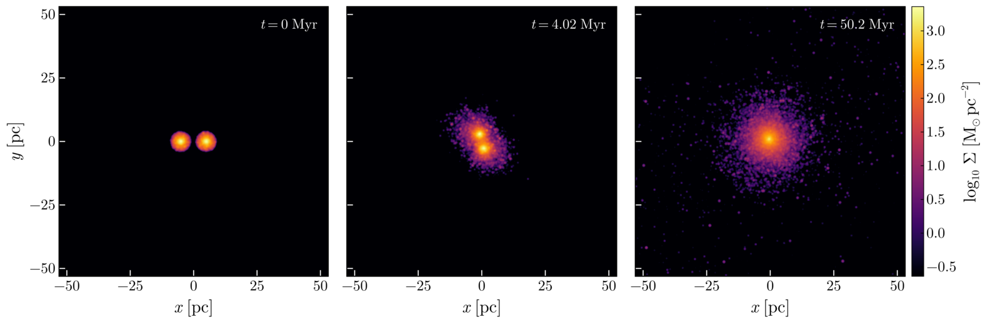
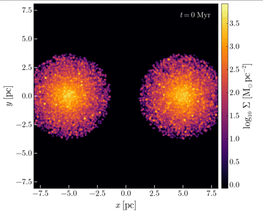

# Nbody6Dynamics.jl

| Documentation | Build and tests | Code quality | Release |
|:-:|:-:|:-:|:-:|
| [](https://PaulGoG.github.io/Nbody6Dynamics.jl/stable/) | [](https://github.com/PaulGoG/Nbody6Dynamics.jl/actions/workflows/CI.yml)<br>[](https://github.com/PaulGoG/Nbody6Dynamics.jl/actions/workflows/Backend.yml)<br>[](https://codecov.io/gh/PaulGoG/Nbody6Dynamics.jl) | [](https://github.com/PaulGoG/Nbody6Dynamics.jl/actions/workflows/Format.yml)<br>[](https://github.com/JuliaTesting/Aqua.jl)<br>[](https://github.com/aviatesk/JET.jl) | [](https://github.com/PaulGoG/Nbody6Dynamics.jl/releases)<br>[](https://julialang.org)<br>[](LICENSE) |

A Julia package that runs [Nbody6PPGPU-beijing](https://github.com/nbody6ppgpu/Nbody6PPGPU-beijing) star-cluster simulations end to end: it clones and builds the Fortran engine, generates initial conditions for single clusters and multi-cluster mergers, launches and supervises the integration (with restart dumps, wall budgets and resumption across queue segments), reads every standard output file, computes the cluster diagnostics and draws the figures. One TOML configuration drives every phase through a single entry point, `run_pipeline`.



*Two King clusters of 25 000 stars each, released 10 pc apart at the apocentre of an orbit of
eccentricity 0.5, drawn as projected surface mass density: the pair at release, the two cores
still distinct at 4 Myr, and the remnant with its halo at 50 Myr. The integration took 34 min
of engine time on the AVX build at eight threads of a laptop (Intel Core Ultra 7 155H); the same
case ran in 6–8 min on a datacentre or desktop GPU. Initial conditions, integration, analysis and
figure were all produced by this package; the case is `input_files/showcase/flagship_pipeline.toml`.*



*The same run animated on fixed axes, one frame per 2 Myr. The cores fall together and merge
between 6 and 8 Myr; the remnant then relaxes while its halo of loosely bound stars spreads past
the frame, which holds 99 % of the mass at every epoch. Every run writes animations like this
one alongside its static figures.*

## Project structure

```
Nbody6Dynamics/
├── Project.toml      # Package metadata and dependencies
├── activate.jl       # Activates and instantiates the package environment
├── config.toml       # Main pipeline configuration (edit this)
├── CONTRIBUTING.md   # What a change needs
├── src/              # Library: core types and config; pipeline/, analysis/, io/, ic/
├── ext/              # Makie extension: figures and animations
├── scripts/          # CLI entry points
├── input_files/      # Shipped inputs by purpose: engine/, clusters/, mergers/, verification/, sweeps/, showcase/, gpu/
├── test/             # Unit and physics-validation suite
├── bench/            # Benchmarks and scaling scripts
├── docs/             # Documenter.jl site sources
├── assets/           # Shipped tables: the estimator calibration (assets/calibration/)
├── deps/cuda/        # NVIDIA samples headers used by the CUDA build
├── deps/engine/      # Corrections applied to the engine source before the build
├── backend/          # (gitignored) engine checkout and build
└── runs/             # (gitignored) run outputs
```

The full tree is at the end of this file.

## Installation

Requires Julia ≥ 1.13, installed through [juliaup](https://github.com/JuliaLang/juliaup) (`juliaup add release`). The package is not registered; add it to a project of your own by URL, together with a Makie backend for the figures:

```julia
using Pkg
Pkg.add(url = "https://github.com/PaulGoG/Nbody6Dynamics.jl")
Pkg.add("CairoMakie")
```

```julia
using CairoMakie, Nbody6Dynamics
cfg = load_config("config.toml")        # your project's configuration
results = run_pipeline(cfg)
```

The directory of that `config.toml` is the project directory: the engine is cloned and built under its `backend/` and the runs land under its `runs/`, never inside the package. The shipped inputs are reachable with `example_input("N1k_quick.inp")`, and `example_input("showcase/equal_pipeline.toml")` returns a complete pipeline configuration to copy and edit (copy `equal_merger.toml` beside it, since its paths are relative to its own directory). Building the Fortran engine needs `git`, `gfortran` and `make`, and optionally HDF5 and CUDA (auto-detected; see `[build]` in `config.toml`).

## Environment setup of a checkout

Development and the validated hosts run Julia 1.13. Manifests are not under version control: each environment resolves from its `Project.toml` on first activation, and every run stores the manifest it resolved as `environment_manifest.toml` in its run directory.

Every environment ships an activation script that activates and instantiates it silently. Running one on a new machine performs the dependency resolution and precompilation once:

```bash
julia activate.jl          # package environment (required)
julia scripts/activate.jl  # entry scripts: the package plus its figure backend
julia docs/activate.jl     # documentation build (optional)
julia bench/activate.jl    # benchmarks (optional)
```

An interactive session starts with `julia -i activate.jl`.

The scripts under `scripts/`, `docs/` and `bench/` include their environment's activation script, so they need no project flag; those environments develop the package by a relative path and always run against the local source.

### Figures are an extension

The figure routines are a package extension triggered by a Makie backend, so a headless host installs no plotting stack. Initial conditions, engine build, integration, readers, diagnostics and benchmarks all run without them.

```julia
using CairoMakie        # brings in every plot_*, animate_* and generate_plots
using Nbody6Dynamics
```

Without a backend the figure routines report the remedy instead of failing obscurely, and a pipeline whose `[visualization] enabled = true` is refused before it builds or integrates anything rather than after. `plotting_available()` answers the question in code. The entry scripts under `scripts/` load CairoMakie for you; a numerics-only session (`julia activate.jl`, then `using Nbody6Dynamics`) does not.

## Entry points

One invocation each; details in the sections below.

| Task | Invocation |
|------|------------|
| Instantiate the package environment | `julia activate.jl` |
| Instantiate the script environment (figures) | `julia scripts/activate.jl` |
| Run the main pipeline | `julia scripts/run_setup.jl [config.toml]` |
| Continue a stopped or interrupted run | `julia scripts/run_resume.jl <run_dir>` (one segment per call; post-processing and figures once the run is complete) |
| Submit a run as a chain of Slurm jobs | `julia scripts/run_cluster.jl config.toml [--dry-run] [--run-id=<id>]` (`[cluster] enabled = true`; one job per engine segment, the job script generated into the run directory) |
| Generate a single cluster or a merger and run it | `julia scripts/run_setup.jl input_files/showcase/equal_pipeline.toml` (the showcase cases; a single-cluster case: `[merger] config_file = "input_files/clusters/imbh_runaway.toml"`) |
| Run a parameter sweep | `julia scripts/run_sweep.jl input_files/sweeps/sweep_demo.toml [--dry-run]` |
| Run the verification suite | `julia scripts/run_verif_suite.jl` |
| Regenerate the estimator calibration table | `julia -t 6 scripts/calibrate_estimators.jl` (`--quick` for a schema check; writes `assets/calibration/`) |
| Execute the test suite | `julia -e 'include("activate.jl"); Pkg.test()'` |
| Run the benchmarks | `julia bench/benchmarks.jl` |
| Validate a CUDA host | `julia scripts/run_gpu_validation.jl` (`--dry-run`, `--stages=`, `--stop-on-failure`; results under `runs/gpu_validation_<host>_<timestamp>/`) |
| Build and run on a CUDA host by hand | `julia scripts/run_setup.jl input_files/gpu/gpu_pipeline.toml` (CPU reference: `cpu_pipeline.toml`; recipe in the manual) |
| Measure the GPU speed-up | `julia bench/gpu_scaling.jl 20000,50000 4,8 "0;0,1" 0.25` (needs the CPU and the GPU binary) |
| Measure the device's FP32 peak | `julia bench/fp32_peak_probe.jl --out=runs` (`--backend=cpu` without a device) |
| Build the documentation | `julia docs/make.jl` (executes the walkthrough; the site lands in `docs/build/`) |

## Usage

`run_pipeline(cfg)` is the single entry point; `config.toml` flags select which phases run. Six modes:

| # | Mode | Config flags |
|---|------|--------------|
| 1 | Full pipeline | `install.enabled=true`, `simulation.run_test=true` |
| 2 | Simulate only | `install.enabled=false`, `simulation.run_test=true` |
| 3 | Postprocess only | `simulation.run_test=false`, `postprocess.data_dir="/path/to/output"` |
| 4 | Re-plot latest run | `simulation.run_test=false`, `postprocess.data_dir=""` |
| 5 | Merger ICs only | `merger.enabled=true`, `merger.config_file="input_files/..."` |
| 6 | Merger + simulate | `merger.enabled=true`, `simulation.run_test=true` |

```julia
using Nbody6Dynamics
cfg = load_config("config.toml")
results = run_pipeline(cfg)   # Dict; includes :snapshots, :diagnostics, :lagr, :escapers, :stellar_evo, …
```

Or via the CLI wrapper:

```bash
julia scripts/run_setup.jl [config.toml]
```

Initial conditions alone, without a pipeline configuration (a single cluster or a merger; the file decides):

```julia
result = run_merger_pipeline("input_files/clusters/gc_bh_subsystem.toml")
# writes dat.10, merger.inp, merger_summary.txt, merger_ic.toml and the IC figures
```

Post-process any directory containing Nbody6++ output, config-free:

```julia
scan = scan_output("/scratch/sim42/output")     # report available files
results = postprocess_external("/scratch/sim42/output")
```

Each run gets an isolated `runs/<run_id>/` directory (`output/`, `plots/`, frozen `config.toml`, `RUN_INFO.toml` with one entry per engine segment). Run IDs come from `generate_run_id` (prefix + timestamp + 4-hex uniqueness suffix); runs from generated initial conditions prepend `merger_` to the configured prefix.

## Status

| Component | Status | Notes |
|-----------|--------|-------|
| Install / build | Working | Clones my engine fork at its release tag `v2026.07.11` (any upstream ref also builds, with the source amendments of `deps/engine/amendments.toml`), runs `configure` and a parallel make, and writes `BUILD_INFO.toml` next to the binary. GPU builds target the visible devices' compute capabilities or an explicit `cuda_arch` list; validated on five CUDA hosts (compute capability 7.5 to 12.0, CUDA 11.8 to 13.3, see the manual, Validated hardware) |
| Initial-condition generator | Working | Plummer and King clusters with a Kroupa (2001) IMF, alone, as a Kepler pair, on explicit orbits or as a cluster complex with its energy-matched controls, each cluster truncated at its Roche lobe (Eggleton 1983) with respect to its neighbour. Primordial mass segregation (Baumgardt, De Marchi & Kroupa 2008), primordial binaries with the Sana et al. (2012) branch for massive primaries and a periastron Roche guard, IMBH seeding (`kz24` and `flag` routes), seeded throughout; output intervals are dyadic rationals, which upstream builds need (my fork bounds the digit counter since `v2026.07-campaign.3`) |
| Snapshot integrals and bound sets | Working | Exact Newtonian potential in Float64 with regularised pairs as centres of mass, and the bound set by iterative energetic unbinding with an explicit convergence status. Per snapshot the momenta, energies, the pairs' internal energy and the Jacobi integral of a linearised tide (`snapshot_integrals.csv`) |
| Energy-jump localisation and mass budget | Working | The engine's `DE` per adjustment interval with its correction channels and event counts, flagged by a floor and a robust scale (`energy_intervals.csv`, `engine_events.csv`). Mass and energy closed per snapshot against escapers, stellar-evolution and collision losses and the engine's corrections (`mass_budget.csv`, `energy_budget.csv`) |
| Remnant diagnostics | Working | Core radii, density, half-mass radius, rotation with sign-flip floors, mass segregation (Λ_MSR, Λ̃_MSR, Γ_MSR), coalescence time and core-collapse markers of the bound remnant per snapshot (`remnant_diagnostics.csv`, four figures per merger run) |
| Angular momentum, equipartition, merger tree | Working | Angular-momentum budget and rotation by radius and initial-mass class (`angular_momentum.csv`), the Bianchini equipartition mass (`equipartition.csv`), and the merger tree with the per-progenitor mass budget (`merger_tree.csv`, `progenitor_budget.csv`) |
| Binaries | Working | KS episodes joined per pair into spans with origin and end class (`binary_spans.csv`), physically bound pairs and their spans across the snapshots (`bound_spans.csv`), their union per pair (`binary_census.csv`), binary fractions per shell, stellar class and census level (`binary_population` stage, `binary_population.csv`), pair-type composition and hardness (`binary_pair_types.csv`), orbital-element distributions (`binary_distributions.csv`) the gravitational-wave catalogues of the compact pairs (`compact_binary_catalogue.csv`, `escaped_binary_catalogue.csv`, `gw_merger_catalogue.csv`) with the export of the quasi-circular pairs as an LDC galactic-binary table (`ldc_galactic_binaries.csv`, `ldc_export`), the collision catalogue with progenitor tags (`collision_catalogue.csv`, on by default) and the lifetime statistics (`binary_survival.csv`, `binary_incidence.csv`); figures: timeline, population series, survival curves, a–e and f–e planes; the binary stages are off by default |
| IMBH diagnostics | Working | For a run seeded with one or several IMBHs (`[imbh]` of `merger_ic.toml`, up to 16 under the flag route, on by default), per IMBH and with an `imbh_name` column: its offset and velocity about the stellar density centre with the core and half-mass radii of the stars (`imbh_trajectory.csv`), the wandering moments against the Brownian predictions of a Plummer sphere and a harmonic core (`imbh_wandering.csv`), the most bound two-body companion per snapshot with its elements and Peters time (`imbh_companions.csv`), and the tidal disruptions, collisions, coalescences, GW recoils and escape of the IMBH (`imbh_events.csv`); for several IMBHs the two-body state, elements, Kepler period and Peters time of every pair (`imbh_pairs.csv`); reader of the engine's `mbh.45`; figures: wandering, companions, one each per IMBH |
| Gravitational-wave observables | Working | `gw_inspiral_time` (Peters 1964), `chirp_mass`, `gw_frequency` (f₂₂, Wen 2003 peak, pericentre) and `eccentricity_at_frequency` along the Peters track; strains: the Peters–Mathews harmonic power `peters_mathews_g`, the LDC 22-mode amplitude `gw_amplitude_ldc`, and the harmonic and characteristic strains of LEGWORK (Wagg et al. 2022) `gw_harmonic_strain`, `gw_characteristic_strain`, stored per kpc in the catalogues |
| Validity record | Working | Energy, mass and angular-momentum checks with a verdict, snapshot cadence, the windows excluded from equilibrium estimators and the calibrated bias of the tracked estimators (`validity.toml`, `validity_snapshots.csv`) |
| Shape, segregation and mixing | Working | Axis ratios from the iterative shape tensor (Zemp et al. 2011), projected ellipticities, the A⁺ index, the two-sample Kolmogorov–Smirnov distance with its null floor, and the mixing of two tagged populations |
| Stellar population | Working | Engine grouping of the stellar types (`STELLAR_CLASSES`), the HR-plane population and a class census per epoch (`stellar_census.csv`) |
| Parameter sweeps | Working | Cartesian grids over merger-TOML keys × seeds run as concurrent worker processes, with an index, a summary table, comparison figures, seeded ensembles with 68/95 % bands and isolated single-cluster controls. A point counts as done only when its run completed |
| Simulation runner | Working | Launch script with thread and device control, live monitoring, start-up and stall watchdogs (`startup_timeout`, `stall_timeout`), telemetry and a wall budget per segment that stops the engine with a restart dump. `resume_run` and the Slurm job chain of `submit_run` continue a run; every segment is closed in `RUN_INFO.toml` with a status (`completed`, `stopped`, `halted`, `watchdog`, `stalled`, `killed`, `failed`) |
| I/O readers | Working | `conf.3`, `out1000` (ADJUST records, scaling, event lines), `event.35`, `lagr.7`, `esc.11`, `sev.83_*` and `bev.82_*`; `read_binary_events` for the KS, few-body and GW lines (`GR CAPTURE` and `GR FLYBY` included); readers of `bdat.9`, `bwdat.19`, `merger.84`, `hiarch.12`, `coll.13`, `coal.24`, `cmbody.26`, `binev.17`, `degen.4`, `escbin.31` and `hbin.39`. `.h5part` files are reported as unsupported |
| Plotting / animation | Working | Publication theme with Computer Modern fonts, configured in `[visualization.style]`; escaper, stellar-evolution, binary, merger and remnant figures and GIF animations, never overwriting an existing figure |
| Load latency | Working | PrecompileTools workload over the configuration, diagnostics-reader and merger-IC paths |
| Tests | Passing | Unit and physics-validation suite with static QA (Aqua, JET, ExplicitImports); engine-dependent tests behind `NBODY6_BINARY_TESTS=1`, a GPU set behind `NBODY6_GPU_TESTS=1` |

## Testing

```bash
julia -e 'include("activate.jl"); Pkg.test()'
```

The default suite needs no Fortran binary. The engine-dependent tests (build, launch, restart, tidal field, live telemetry) run when `NBODY6_BINARY_TESTS=1` is set; without `NBODY6_BACKEND_ROOT` they clone and build the backend in a temporary directory, with it they use the build under `<root>/backend/Nbody6PPGPU-beijing`:

```bash
NBODY6_BINARY_TESTS=1 NBODY6_BACKEND_ROOT=$PWD julia -e 'include("activate.jl"); Pkg.test()'
```

The suite covers config round-trips, all I/O readers (synthetic binaries plus fixtures of real upstream engine output, commit `618d7a4`, under `test/fixtures/`), plotting/animation smoke tests, external post-processing (including adversarial malformed inputs), and the merger IC generator. Physics-validation tests check King concentration c(W0) against published values, the Plummer half-mass relation r_hm = 1.305 a, the Kroupa mean mass, virial equilibrium Q = T/|W| = 0.5 after `virialise!`, and the Keplerian orbital energy of generated two-cluster orbits.

For interactive work against the test dependencies, activate the test environment with [`TestEnv.jl`](https://github.com/JuliaTesting/TestEnv.jl): start `julia -i activate.jl` and run `using TestEnv; TestEnv.activate()` in the session.

## Verification Suite

```bash
julia scripts/run_verif_suite.jl
```

Runs three end-to-end targets through `run_pipeline` (requires a built binary in `backend/`):

1. `single` — plain N=5000 run (`N5k_medium.inp`)
2. `triorbit` — bound three-cluster Lagrange triangle (`verif_triorbit.toml`)
3. `3d5cluster` — five clusters distributed in 3D (`verif_3d5cluster.toml`)

## Documentation

The documentation site (Manual, Input Files, Showcase Cases, Cluster Mergers, API Reference, References, a walkthrough from a merger TOML to the generated initial conditions) is at [paulgog.github.io/Nbody6Dynamics.jl/dev](https://PaulGoG.github.io/Nbody6Dynamics.jl/dev/). It builds from `docs/`:

```bash
julia docs/make.jl   # builds to docs/build/
```

## Contributing

Issues and pull requests are welcome; `CONTRIBUTING.md` says what a change needs (tests, formatting, docstrings, a changelog entry, and the formulation behind any physics).

## Licence

The package is released under the MIT licence (`LICENSE`). Two other parties' material is involved. The CUDA helper headers under `deps/cuda/` come from NVIDIA's cuda-samples and carry their BSD-3-Clause licence (`deps/cuda/LICENSE`). The engine is not part of this package: the install phase clones it at build time, by default from my fork [PaulGoG/Nbody6PPGPU-beijing](https://github.com/PaulGoG/Nbody6PPGPU-beijing) at a tagged release of its `main` branch, and nothing of it is redistributed here. The upstream repository, [nbody6ppgpu/Nbody6PPGPU-beijing](https://github.com/nbody6ppgpu/Nbody6PPGPU-beijing), carries no licence file; the fork's `NOTICE.md` states the provenance, the credit due to the code's authors, the MIT terms of the earlier public repository of the code under which I treat the inherited code, and the MIT licence of my own modifications.

## How to cite

If this package contributes to published work, please cite it through the metadata in `CITATION.cff`:

```bibtex
@software{Nbody6Dynamics_jl,
  author  = {Gogîță, Paul-Adrian},
  title   = {Nbody6Dynamics.jl},
  version = {0.5.0},
  year    = {2026},
  url     = {https://github.com/PaulGoG/Nbody6Dynamics.jl},
  license = {MIT}
}
```

## Full tree

<details><summary>Full project tree</summary>

```
Nbody6Dynamics/
├── .github/                         # CI, Format, Documentation and Backend workflows; Dependabot; issue and PR templates
├── .JuliaFormatter.toml             # Formatter configuration
├── .mailmap                         # Author identities folded into one
├── README.md
├── CONTRIBUTING.md                  # What a change needs
├── LICENSE                          # MIT
├── CITATION.cff                     # Citation metadata
├── CHANGELOG.md                     # Release history (Changelog.jl conventions)
├── Project.toml                     # Package metadata & dependencies
├── activate.jl                      # Activates and instantiates the package environment
├── config.toml                      # Main pipeline configuration (edit this)
├── assets/calibration/              # estimators.csv (bias, scatter, errors of every estimator versus N on the static models) and estimators.toml (version, grid, seeds)
├── deps/activation.jl               # Shared by the activate.jl scripts: resolves a manifest left stale by a dependency change
├── deps/cuda/                       # helper_cuda.h, helper_string.h from NVIDIA cuda-samples v13.0 (CUDA 13 build of the engine) and their LICENSE (BSD-3-Clause)
├── deps/engine/amendments.toml      # Source corrections applied to an upstream engine tree before configure (escaper summary format, tidal energy in the total under a linearised tide)
├── src/
│   ├── Nbody6Dynamics.jl            # Module root; run_pipeline orchestrator; exports
│   ├── types.jl                     # Config structs (incl. PlotStyle), Snapshot, records, UnitScaling
│   ├── config.jl                    # TOML loader/serialiser for Nbody6Config
│   ├── util.jl                      # safesave-style never-overwrite backups
│   ├── plotting_api.jl              # Figure interface: the public routines, implemented by the Makie extension
│   ├── pipeline/                    # Engine build, launch, resumption, Slurm chains, cost, telemetry, sweeps
│   │   ├── platform.jl              # OS/CUDA/dependency detection, hardware fingerprint
│   │   ├── install.jl               # Clone, configure, HDF5 Makefile patch, build
│   │   ├── telemetry.jl             # Runtime CPU/memory/GPU telemetry of the backend process tree
│   │   ├── run.jl                   # Simulation launcher: run dirs, launch script, live monitoring
│   │   ├── resume.jl                # Restart dump selection, the join of segments (what a killed segment wrote after its dump is moved aside)
│   │   ├── cost.jl                  # Cost model: rate table, wall-time, segment and disk estimate at launch, budget check
│   │   ├── cluster.jl               # Slurm layer: generated job script, submission and chaining of segments, job ledger
│   │   ├── gpu_validation.jl        # run_gpu_validation: logged validation stages of a CUDA host under runs/
│   │   ├── sweep.jl                 # Parameter sweeps: grid × seeds, concurrent worker processes, index and summary
│   │   └── external.jl              # scan_output + postprocess_external for arbitrary output dirs
│   ├── analysis/                    # Diagnostics derived from the output: integrals, budgets, structure, binaries, validity
│   │   ├── potential.jl             # Exact pair-sum potential (KernelAbstractions), pairs as centres of mass, bound sets
│   │   ├── integrals.jl             # Snapshot integrals: momenta, energies, bound set; snapshot_integrals.csv
│   │   ├── energy_events.jl         # Energy-jump localisation: adjustment intervals, correction channels, event counts; energy_intervals.csv, engine_events.csv
│   │   ├── budgets.jl               # Mass and energy budgets per snapshot: escapers, stellar-evolution and collision losses, engine corrections; mass_budget.csv, energy_budget.csv
│   │   ├── cluster_structure.jl     # Per-cluster structure from snapshots: bound members, centres, radii, dispersions
│   │   ├── binary_population.jl     # Binary diagnostics: Heggie hard/soft split, binary fraction, energy scale from snapshots
│   │   ├── stellar_population.jl    # Stellar classes, HR-plane population, class census
│   │   ├── remnant.jl               # Remnant diagnostics: coalescence, Casertano–Hut core radius, rotation, mass segregation
│   │   ├── shape_mixing.jl          # Shape tensor, projected ellipticity, A⁺ index, two-sample D, mixing of two populations
│   │   ├── pair_finder.jl           # k-d tree local density, snapshot binary finder, reconciliation with the KS pairs
│   │   ├── equipartition.jl         # Bianchini equipartition-mass fit and its per-snapshot series; equipartition.csv
│   │   ├── angular_momentum.jl      # Angular-momentum budget, rotation by radius and mass class, elapsed relaxation times; angular_momentum.csv
│   │   ├── merger_tree.jl           # Merger tree from the density-centre separations, per-progenitor mass budget and mixing; merger_tree.csv, progenitor_budget.csv
│   │   ├── validity.jl              # Validity record of a run and the calibration-table lookup; validity.toml, validity_snapshots.csv
│   │   ├── binary_spans.jl          # Engine-regularised binary spans: KS episodes joined per pair, origin, end class; binary_spans.csv
│   │   ├── bound_spans.jl           # Physically bound pairs at the snapshots and their spans; bound_spans.csv
│   │   ├── binary_census.jl         # Union of the regularised and the bound spans per pair; binary_census.csv
│   │   ├── gw_observables.jl        # Peters inspiral time, chirp mass, GW frequencies, eccentricity at a reference frequency
│   │   ├── binary_population_series.jl # Binary fractions per shell, stellar class and census level; pair types, hardness, element distributions
│   │   ├── gw_catalogues.jl         # Compact-binary, escaped-binary and GW-merger catalogues; band residence times on the Peters track
│   │   ├── collision_catalogue.jl   # Collisions and coalescences tagged with the progenitor cluster of each star
│   │   ├── survival.jl              # Kaplan–Meier, Nelson–Aalen, Aalen–Johansen, Turnbull, log-rank, Cox–Snell for binary lifetimes
│   │   ├── imbh.jl                  # IMBH trajectory about the density centre, Brownian wandering, bound companions, event list
│   │   └── ensemble.jl              # Seeded ensembles: series extractors, common-grid percentiles (median, 68/95 %)
│   ├── io/
│   │   ├── io.jl                    # I/O submodule includes
│   │   ├── fortran_binary.jl        # Fortran unformatted record reader
│   │   ├── fortran_format.jl        # Fixed-width reads of formatted records by their FORMAT field widths (read_fixed)
│   │   ├── conf3.jl                 # conf.3 snapshot reader (standard + extended layout; stars only)
│   │   ├── diagnostics.jl           # out1000 parser: ADJUST lines with the energy terms, PHYSICAL SCALING, options and tidal echoes
│   │   ├── lagr.jl                  # lagr.7 Lagrangian radii reader
│   │   ├── esc.jl                   # esc.11 escaper reader (fork's real column format)
│   │   ├── events.jl                # out1000 event lines, event.35 counters
│   │   ├── binary_events.jl         # read_binary_events: the binary, few-body and GW lines of out1000 in one pass (BinaryEventLog)
│   │   ├── events_dynamics.jl       # KS, chain, triple, quad, hierarchy, exchange and termination records
│   │   ├── events_evolution.jl      # GW, binary-escape, mass-loss, tidal and Roche records
│   │   ├── binary_files.jl          # bdat.9, bwdat.19, merger.84, hiarch.12, coll.13, coal.24, cmbody.26, binev.17, degen.4, escbin.31, hbin.39
│   │   ├── mbh45.jl                 # mbh.45 IMBH record reader (bhplot.f, KZ(24) = 1)
│   │   ├── stellar_evolution.jl     # sev.83_* single-star evolution reader
│   │   └── binary_evolution.jl      # bev.82_* regularised-binary reader
│   └── ic/
│       ├── ic.jl                    # run_merger_pipeline / generate_merger_ic entry points
│       ├── config.jl                # IC TOML parser: ClusterSpec, OrbitSpec, Nbody6ParameterSpec (presets), stellar and tidal specs
│       ├── control.jl               # Isolated single-cluster control derived from a merger TOML
│       ├── complex.jl               # Cluster complexes: member masses and radii, centre distributions, bulk velocity scaling
│       ├── segregation.jl           # Primordial mass segregation: McLuster slot order, energy-ranked BDK08 slices
│       ├── models.jl                # Plummer & King (ODE-solved) density samplers
│       ├── rotating_king.jl         # Einsel & Spurzem (1999) rotating King model: Legendre–Poisson solution and exact sampling
│       ├── static_models.jl         # Static test models: Osipkov–Merritt Plummer, Lynden-Bell flip, stretched, energy-ranked masses
│       ├── imf.jl                   # Kroupa (2001) IMF, rescaled, equal-mass and single power-law variants
│       ├── orbits.jl                # Kepler two-body (size, orientation, derived quantities), explicit and single placement, tidal frame, Jacobi radii
│       ├── binaries.jl              # Primordial binary populations; Sana 2012 and Moe & Di Stefano 2017 branches for massive primaries, periastron Roche guard
│       ├── stellar_radius.jl        # ZAMS radii of the engine (Tout et al. 1996 fit of SSE)
│       ├── imbh.jl                  # IMBH seeding (kz24 route): placement, Brownian velocity, isotropic Jeans response
│       └── output.jl                # dat.10 writer, merger.inp generator, integration-parameter resolution per preset
├── ext/
│   ├── Nbody6DynamicsMakieExt.jl    # Extension module, loaded by `using CairoMakie`
│   └── plotting/
│       ├── common.jl                # Publication theme (Computer Modern fonts), figure sizing, axis helpers
│       ├── dispatch.jl              # generate_plots: the single figure dispatcher
│       ├── snapshots.jl             # Projection figures (surface density or scatter), cluster separation & per-cluster virial
│       ├── energy.jl                # Energy error & particle count from diagnostics
│       ├── lagrangian.jl            # Lagrangian radii evolution
│       ├── hr.jl                    # HR figures: run-level legend, panels, census strip; HR animation
│       ├── escapers.jl              # Escaper analysis: cumulative mass loss, velocities, anisotropy
│       ├── sse.jl                   # SSE-quantity plots: mass segregation, t/T_MS clock, core masses
│       ├── merger.jl                # Merger-run figures: separation, per-cluster virial and structure
│       ├── merger_ic.jl             # Merger IC diagnostic figures
│       ├── binaries.jl              # Binary population, a–e diagram, period distribution
│       ├── binary_diagnostics.jl    # Binary timeline, population series, survival curves, a–e and f–e planes
│       ├── imbh.jl                  # IMBH figures: wandering against the Brownian predictions, bound companions
│       ├── remnant.jl               # Remnant figures: rotation parameters and profile, structure, mass segregation
│       ├── sweep.jl                 # Sweep comparison figures on common axes (Lagrangian radius, energy error)
│       ├── control.jl               # Merger against isolated control, paired series per sweep point
│       ├── ensemble.jl              # Ensemble figures: median and 68/95 % bands per grid point
│       ├── animation.jl             # GIF animations (cluster, HR, Lagrangian)
│       └── telemetry.jl             # Run telemetry figure
├── scripts/
│   ├── run_setup.jl                 # CLI wrapper: load config → run_pipeline
│   ├── run_resume.jl                # CLI wrapper: resume_pipeline on a run directory
│   ├── run_cluster.jl               # CLI wrapper: submit_run — a run as a chain of Slurm jobs
│   ├── run_cluster_segment.jl       # Job entry: cluster_segment on a run directory (called by the generated job script)
│   ├── run_sweep.jl                 # CLI wrapper: sweep TOML → run_sweep → comparison figures
│   ├── run_verif_suite.jl           # Three-target verification suite
│   ├── calibrate_estimators.jl      # Bias and variance of every estimator on the static models versus N → assets/calibration/
│   ├── run_gpu_validation.jl        # CLI wrapper: logged validation stages of a CUDA host
│   ├── activate.jl                  # Activates the script environment (package + CairoMakie)
│   └── Project.toml                 # Script environment: the package and its figure backend
├── test/
│   ├── runtests.jl                  # Suite entry: shared helpers, includes the component files below
│   ├── test_config.jl               # Configuration loading, round trip, validation
│   ├── test_platform_build.jl       # Platform and CUDA detection, engine source tree, GPU build target
│   ├── test_validation.jl           # GPU validation driver and stage verdicts
│   ├── test_run.jl                  # Run IDs, machine identity, watchdogs, restarts, provenance
│   ├── test_resume.jl               # Dump completeness, dump selection, the join on synthetic run directories
│   ├── test_cluster.jl              # Job script rendering, submission chains against a stand-in sbatch, segments and ledger
│   ├── test_cost.jl                 # Rate table, estimate arithmetic, input reader, launch-time budget check
│   ├── test_io.jl                   # Readers: conf.3, out1000, lagr.7, esc.11, sev.83, bev.82, fixtures
│   ├── test_fortran_format.jl       # Fixed-width reads of formatted records
│   ├── test_events_dynamics.jl      # KS, few-body, hierarchy, exchange and termination lines
│   ├── test_events_evolution.jl     # GW, escape, mass-loss, tidal and Roche lines
│   ├── test_binary_files.jl         # Readers of the binary and few-body output files
│   ├── test_binary_spans.jl         # Engine-regularised binary spans (level E)
│   ├── test_bound_spans.jl          # Bound pairs and their spans (level P)
│   ├── test_binary_census.jl        # Union of the level-E and level-P spans per pair
│   ├── test_gw_observables.jl       # Peters inspiral time, GW frequencies, eccentricity at a frequency
│   ├── test_binary_population.jl    # Binary fractions per shell, stellar class and census level; pair types, frames, distributions
│   ├── test_gw_catalogues.jl        # GW catalogues: Peters track, band residence, catalogue rows from a synthetic event log
│   ├── test_collision_catalogue.jl  # Collision catalogue: progenitor tags, primordial pairs, generations
│   ├── test_survival.jl             # Survival estimators against closed forms and simulated censored samples
│   ├── test_diagnostics.jl          # Binary population, remnant, stellar classes, cluster structure
│   ├── test_potential.jl            # Pair potential, reduced systems, bound sets, snapshot integrals
│   ├── test_energy_budget.jl        # Jacobi integral, energy-jump localisation, mass budget
│   ├── test_static_models.jl        # Estimators against the static test models with known answers
│   ├── test_rotating_king.jl        # Rotating King model against the Einsel & Spurzem (1999) moments
│   ├── test_imbh.jl                 # IMBH seeding: keys and guards, IMBHINIT identity, velocity modes, Jeans response
│   ├── test_imbh_analysis.jl        # IMBH diagnostics: mbh.45 reader, trajectory, wandering, companions, events, writers
│   ├── test_angular_momentum.jl     # Angular-momentum budget and rotation by radius and mass class
│   ├── test_equipartition.jl        # Bianchini equipartition-mass fit
│   ├── test_merger_tree.jl          # Merger tree and per-progenitor budget
│   ├── test_two_cluster_orbit.jl    # Two-cluster orbit by size, orientation, tidal frame
│   ├── test_cluster_complex.jl      # Cluster complexes: member masses, sizes, centres, bulk velocities
│   ├── test_complex_controls.jl     # Global IMF partition and the energy-matched controls
│   ├── test_segregation.jl          # Primordial mass segregation
│   ├── test_massive_binaries.jl     # Sana et al. (2012) and Moe & Di Stefano (2017) branches, the periastron Roche guard
│   ├── test_generator_physics.jl    # Roche truncation, frame conversion, strict cluster tables
│   ├── test_analysis_corrections.jl # Regression tests of the binary and budget analysis
│   ├── test_run_safety.jl           # Run-directory guard, chain stops, completed-run checks
│   ├── test_validity.jl             # Validity record and the calibration lookup
│   ├── test_sweep_ensemble.jl       # Sweeps, seeded ensembles, control configurations
│   ├── test_plotting.jl             # Figure extension, smoke tests, canvases, formatting
│   ├── test_external.jl             # External post-processing
│   ├── test_external_adversarial_inner.jl  # Malformed external inputs, included by test_external.jl
│   ├── test_ic.jl                   # Merger initial-condition generator and its physics checks
│   ├── test_telemetry.jl            # Hardware telemetry sampler, readers and figure
│   ├── test_engine_gated.jl         # Shipped GPU-host configurations; engine- and GPU-gated runs
│   ├── test_qa.jl                   # Static QA: Aqua, ExplicitImports, JET
│   └── fixtures/                    # Upstream engine output excerpts, commit 618d7a4 (esc.11, lagr.7, out1000, sev.83_0, bev.82_0), with their PROVENANCE.md
├── bench/
│   ├── thread_scaling.jl            # Thread- and N-scaling of the backend from run telemetry (cost model)
│   ├── gpu_scaling.jl               # GPU-versus-CPU binary at equal N and threads, per GPU_LIST (speed-up table)
│   ├── gpu_cells.jl                 # Benchmark cells on the device: (cell, N, threads, GPU list, MPI ranks) grid, one CSV row per run
│   ├── gpu_cells_figures.jl         # Scaling (strong, weak, host threads) and cross-hardware figures from the cell CSVs; --synthetic rehearsal
│   ├── fp32_peak_probe.jl           # Measured FP32 peak of the device (GPUDiagnostics), fp32_peak_<host>.toml for the fraction-of-peak panel
│   ├── merger_case.jl               # The single- and dual-cluster cells shared by the scaling scripts
│   ├── benchmarks.jl                # BenchmarkTools suite (kept out of tests)
│   ├── activate.jl                  # Activates the bench environment (package developed by relative path)
│   └── Project.toml                 # Bench-local environment
├── docs/
│   ├── make.jl                      # Documenter.jl build script
│   ├── activate.jl                  # Activates the docs environment (package developed by relative path)
│   ├── Project.toml                 # Documentation build environment
│   ├── src/                         # index, walkthrough (Literate), manual, input_files, showcase, multi_cluster_mergers, api, references
│   ├── src/references.bib           # BibTeX of the sources cited (DocumenterCitations)
│   └── src/assets/                  # figure and animation used by the README and the docs site, with their PROVENANCE.md
├── input_files/                     # Shipped inputs, one folder per purpose (input_files/README.md)
│   ├── engine/                      # Single-cluster engine inputs with engine-generated initial conditions: N1k_quick … N100k_production
│   ├── clusters/                    # Single-cluster generator configurations: the four science cases
│   ├── mergers/                     # Merger initial-condition TOMLs: demo, equal-mass, minor Plummer, triple, 3- and 5-cluster, 27-cluster grid
│   ├── verification/                # verif_triorbit (Lagrange triangle), verif_3d5cluster (five clusters in 3D), replicas/ (published two-cluster mergers)
│   ├── sweeps/                      # sweep_demo (eccentricity × secondary size × seeds over the demo merger)
│   ├── showcase/                    # Five end-to-end cases with Myr intervals: equal, binary, tidal, flagship, sweep with controls
│   └── gpu/                         # CUDA-host recipe: GPU and CPU builds, the 2 × 25k merger, the 6 × 10⁵-body probes
├── backend/                         # (gitignored) cloned Nbody6PPGPU-beijing source + build
└── runs/                            # (gitignored) per-run output/, plots/, frozen config.toml
```

</details>
