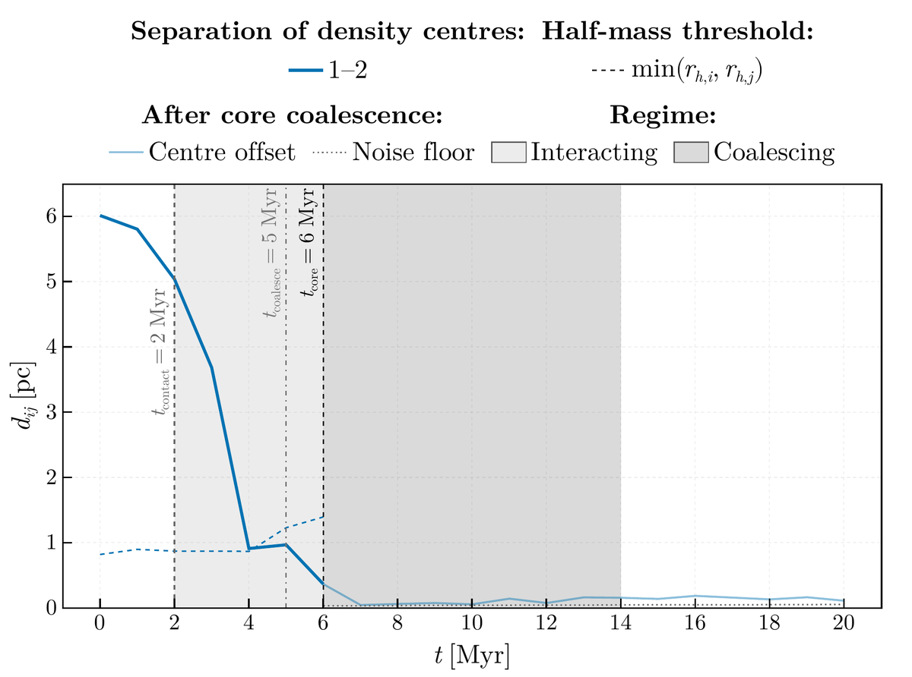
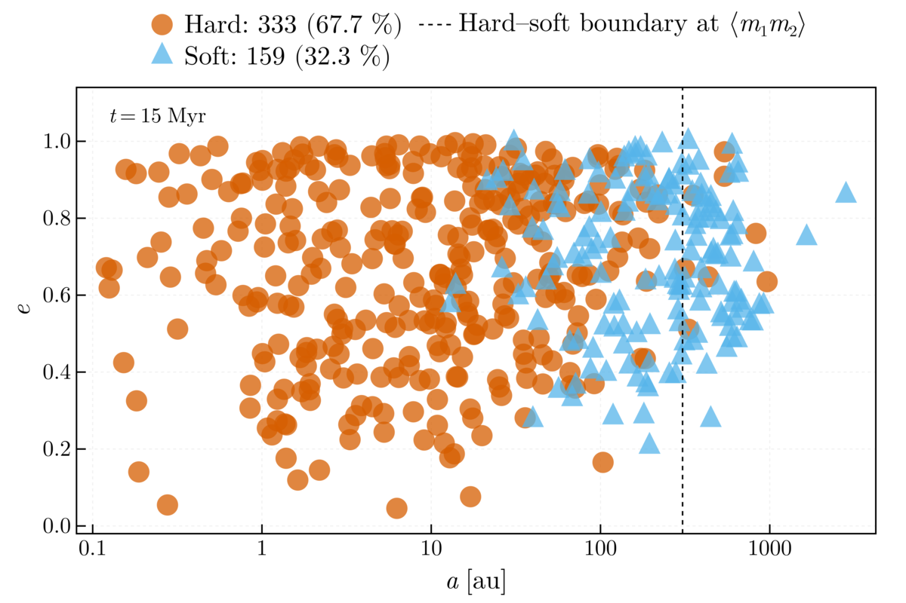
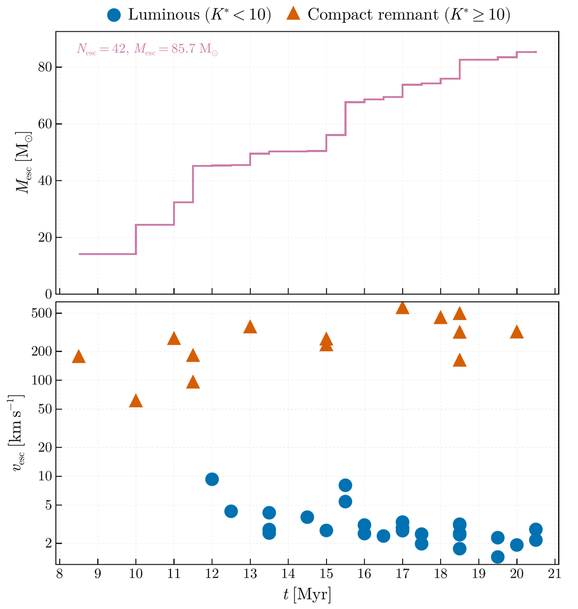
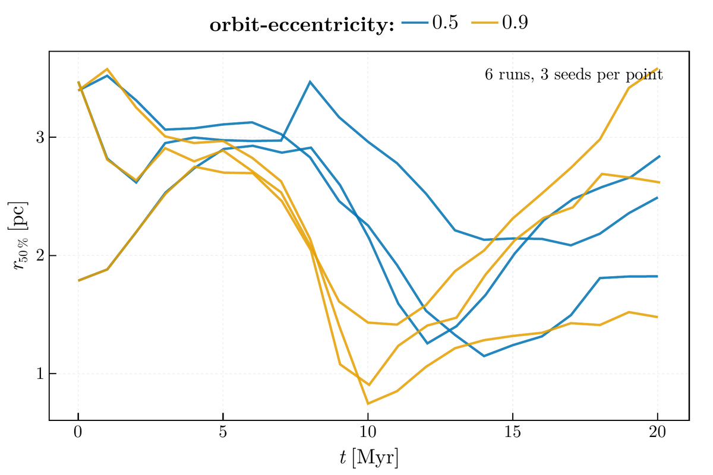
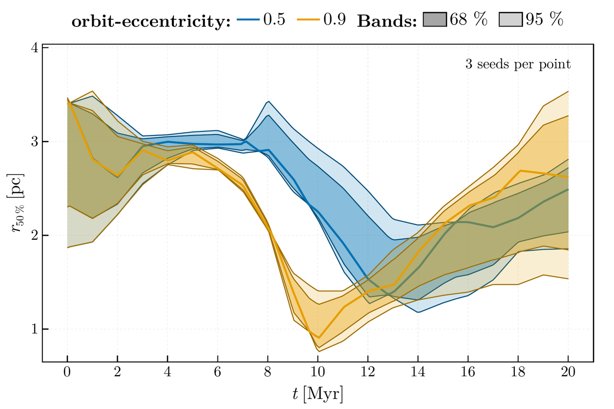

# Showcase Cases

`input_files/showcase/` holds five cases that take the pipeline from a merger
configuration to a finished run with its figures. Four complete within minutes
on a workstation; the fifth is the 3 × 25 000-star triple merger over 50 Myr of
the README. The two-cluster case on which the CUDA path was validated is
`gpu/merger_50k.toml`. Each case is a merger TOML with a matching pipeline TOML
(paths relative to the folder), so one invocation runs it:

```bash
julia scripts/run_setup.jl input_files/showcase/equal_pipeline.toml     # also binary_, tidal_, flagship_
julia scripts/run_sweep.jl input_files/showcase/sweep.toml               # the sweep with its controls
```

Every case gives its intervals in Myr (`tcrit_myr`, `dtadj_myr`, `deltat_myr`,
`dtplot_myr`), so the merger, its isolated control and the points of the sweep
cover the same physical span although their N-body time units differ. The
pipeline TOMLs use the AVX engine built under `backend/Nbody6PPGPU-beijing`
(`gpu/gpu_pipeline.toml` builds the CUDA variant) and write into `runs/`.

## The cases

| Case | Clusters | Orbit | Span | Tolerance `qe` | What it shows |
|---|---|---|---|---|---|
| `equal` | 2 × 4000, King `W0 = 6`, `r_h = 1` pc, Kroupa 0.1–50 M☉ | apocentre 6 pc, `e = 0.9` | 20 Myr | 0.01 | an equal pair that falls together and coalesces within the run; the remnant sheds a halo of loosely bound stars |
| `binary` | 4000 (`W0 = 6`, 1 pc) + 1000 (`W0 = 5`, 0.7 pc), `q ≈ 0.25`, 20 % primordial binaries in both | apocentre 5 pc, `e = 0.7` | 15 Myr | 0.01 | the binary suite (pair counts with the hard/soft split, `a`–`e` diagrams, period distributions) on an unequal pair |
| `tidal` | 2 × 2500 as `equal` | apocentre 6 pc, `e = 0.9`, point-mass galaxy of 10¹¹ M☉ at 8.5 kpc (`KZ(14) = 2`) | 20 Myr | 0.05 | the same encounter inside an external field: escapers removed on the distance criterion, and an engine energy check that measures the tidal work rather than the integration error |
| `sweep` | 2 × 500, King `W0 = 6`, `r_h = 1` pc | apocentre 5 pc, `e ∈ {0.5, 0.9}`, seeds 2, 3, 4, with an isolated control per point | 20 Myr | 0.01 | a twelve-point grid: comparison figures on common axes, seed ensembles with 68/95 % bands, and each merger against its control |
| `flagship` | 3 × 25 000, King `W0 = 6`, `r_h = 2` pc, Kroupa 0.08–100 M☉ | equilateral triangle of side 10 pc, each cluster on a sub-virial rotating orbit about the common centre (1.80 km/s tangential: virial ratio 0.33 of the three point masses after the Roche truncation), explicit placement | 50 Myr | 0.01 | the triple merger of the README: a first close configuration at 6 Myr, a rebound to 7 pc, coalescence of all three at 14 Myr, the remnant to 50 Myr |

The infall time from apocentre is half the Kepler period, so the eccentric
cases coalesce early in the run (`equal` at 5 Myr) and the sweep's two
eccentricities separate in time (12 Myr at `e = 0.5` against 8 Myr at
`e = 0.9`). The clusters of the flagship move at 1.80 km/s tangentially: with
the truncated cluster mass of 1.1×10⁴ M☉ the three point masses have a virial
ratio of 0.33, that of a pair at apocentre with `e = 0.33` (0.25 for the
untruncated 1.5×10⁴ M☉). Its three pairwise separations fall from 10 pc to 5 pc by 6 Myr,
rebound to 7 pc at 8 Myr and drop below the half-mass radii: clusters 1 and 3
join at 12 Myr and cluster 2 at 14 Myr, the centre coalescence of
`coalescence_time` and the last join of the merger tree. The merger epochs
(`merger_epochs`) put the contact of the three at 2 Myr and the core
coalescence of the system at 14 Myr.

## Reference runs

The cases were run on 2026-11-02 on a laptop (Intel Core Ultra 7 155H, four
OpenMP threads per run and eight for the flagship, the cases one after another;
package commit `916fb0a`, the flagship configuration from the commit after it,
engine pin `v2026.07.23`). The shipped pipeline files now pin `v2026.07.27`, so
a rerun differs in detail from the table below. Engine wall time is the
integration alone; the pipeline adds the initial conditions, the readers, the
diagnostics and about fifty figures and five animations per run, a few minutes
at these sizes.

| Case | Run | Bodies after truncation | Engine wall | Final `DETOT` |
|---|---|---|---|---|
| `equal` | `merger_showcase_equal_20261102_165008_d8ff` | 6894 | 176 s | +4.4×10⁻⁴ |
| `binary` | `merger_showcase_binary_20261102_165418_b7bf` | 4212, 703 primordial pairs | 212 s | +5.8×10⁻³ |
| `tidal` | `merger_showcase_tidal_20261102_165852_4a2d` | 4301 | 88 s | +4.2×10⁻³ (`ETIDE` −3.3×10⁻³, the tidal work) |
| `sweep` | `sweep_showcase_20261102_170236` | 737–802 per merger, 995–999 per control | 106–128 s per point, four at a time; all twelve finished | last interval within ±3×10⁻⁶ for the mergers and ±1.4×10⁻⁵ for the controls |
| `flagship` | `merger_showcase_flagship_20261102_170948_a01b` | 58 221 | 3326 s (55 min; AVX build, eight threads) | +2.9×10⁻³ |

`DETOT` is the engine's cumulative energy change at the end of the run, in
N-body energy units; the initial total energies are −0.48 (`equal`, `tidal`),
−1.28 (`binary`) and −0.37 (`flagship`). The merger runs evolve stars and form
binaries, so it sits well above the 10⁻⁷ of a quiet single cluster. The binary
case has the largest value: its 700 primordial pairs lose mass through stellar
evolution while regularised, and the engine books those mass changes in the
energy correction (since `v2026.07.7`; the runs before that pin gave
+3.9×10⁻³). The documentation
assets (`docs/src/assets/`) are rendered from these runs, the README montage
and animation from the flagship; their [provenance record](assets/PROVENANCE.md)
lists the figure routines and arguments.

## What the cases show



*`equal`: the separation of the two density centres falls below the smaller
half-mass radius at 5 Myr, the centre coalescence of `coalescence_time` and
the join of the merger tree; the merger epochs mark the contact at 2 Myr
and the core coalescence at 6 Myr. After the core coalescence the figure no
longer plots a pair separation: it shows the offset between the two density
centres of the remnant against the centre-noise floor. The interacting and
coalescing regimes are shaded.*



*`binary`: the regularised pairs at the end of the run in the a–e plane, hard
and soft by the Heggie criterion at the mean pair mass; the hard fraction
rose from 66 % to 68 % over the 15 Myr as the soft pairs were disrupted.*



*`tidal`: escapers removed at the tidal boundary of the external field. The
luminous stars leave at a few km/s; the compact remnants carry their natal
kicks at 10²–10³ km/s.*



*`sweep`: the half-mass radius of the six mergers on common axes.
The infall is half a Kepler period from apocentre, so the eccentric pairs
collapse first, around 9 Myr, and the `e = 0.5` pairs two to three Myr later;
each remnant then re-expands.*



*`sweep`: the same series as seed ensembles, the median per eccentricity with
its 68 and 95 % bands. Each eccentricity has three seeds, so the bands span
the sample rather than estimate its percentiles. The sweep figures and the
summary use the finished points only.*

## Wall time on the validated hosts

The hardware validation ran a merger of the same size class,
`gpu/merger_50k.toml`: a Kepler pair of two King clusters of 25 000 stars
each. Its integration over 45.8 N-body units, 50.6 Myr, at eight host
threads was measured on 2026-09-24 to 26:

| Host | CUDA build | AVX build |
|---|---|---|
| RTX 5090, Ryzen 9 9950X | 360 s | 636 s |
| RTX 5070 Ti, i9-13900KS | 388 s | 821 s |
| H200 NVL, EPYC 9755 | 454 s | 851 s |
| RTX 2080 Super Max-Q, i7-10750H | 954 s | 2136 s |
| Tesla T4, EPYC 7551P | 1470 s | 4192 s |

At this size the CUDA build is 1.8 to 2.9 times faster than the AVX build.
The irregular force stays on the host in both builds and costs about as much
as the regular force that moves to the device; the gain grows with N (see the
manual, [Validated hardware](@ref)).

## What a run produces

`runs/<run_id>/` holds:

- the record of the run: the frozen `config.toml`, `environment_manifest.toml`, `RUN_INFO.toml` (timing, the thread layout, the hardware fingerprint, the commits, the telemetry summary), `nbody6dynamics.log` and `telemetry.csv`;
- the engine output under `output/`: `BUILD_INFO.toml`, the `conf.3_*` snapshots, `out1000`, `lagr.7`, `esc.11`, `sev.83_*`, `bev.82_*`, and the generated `merger.inp`, `dat.10`, `merger_summary.txt` and `merger_ic.toml`;
- the derived tables: `stellar_census.csv`, `snapshot_integrals.csv`, `energy_intervals.csv`, `engine_events.csv`, `mass_budget.csv`, `energy_budget.csv`, `angular_momentum.csv`, `equipartition.csv`, `remnant_diagnostics.csv`, `progenitor_budget.csv`, `merger_tree.csv`, `merger_epochs.csv`, `pair_separation.csv`, the validity record `validity.toml` with `validity_snapshots.csv`, `collision_catalogue.csv` when the engine logged collisions, and, with their stages on, `binary_spans.csv`, `bound_spans.csv`, `binary_census.csv` and `binary_population.csv`.

The figures under `plots/` are:

- initial conditions: projections, overview, velocity field, sampled IMF, density profiles (`merger_ic_*`);
- the encounter: cluster separation, per-cluster virial ratio and structure, density profiles and velocity dispersions at the first and last snapshot (`merger_*`);
- the system: energy error and particle count, Lagrangian radii, escapers and their anisotropy, snapshots (`energy`, `particle_count`, `lagrangian_radii`, `escapers`, `escape_anisotropy`, `snapshot_*`);
- the stars: HR diagrams at three epochs and their evolution, mass segregation, the evolutionary clock, core masses (`hr_*`, `mass_segregation`, `evolutionary_clock`, `core_mass_growth`);
- the binaries: population and hardness, orbital elements, periods (`binary_*`);
- the remnant: structure, rotation, rotation profile, mass segregation (`remnant_*`);
- the run itself: telemetry (`telemetry`);
- animations: the cluster in three projections, the Lagrangian radii, the HR diagram (`*_anim.gif`, `cluster_evolution_*.gif`).

A sweep adds `sweep_index.toml`, `sweep_summary.csv` and, under its `plots/`,
the comparison figures (`sweep_lagrangian`, `sweep_energy`), the ensemble
bands (`ensemble_*`) and the merger-against-control figure
(`control_lagrangian`). The figure routines are documented in the manual,
[Visualisation](@ref "10. Visualisation"), and in the [API Reference](@ref).
