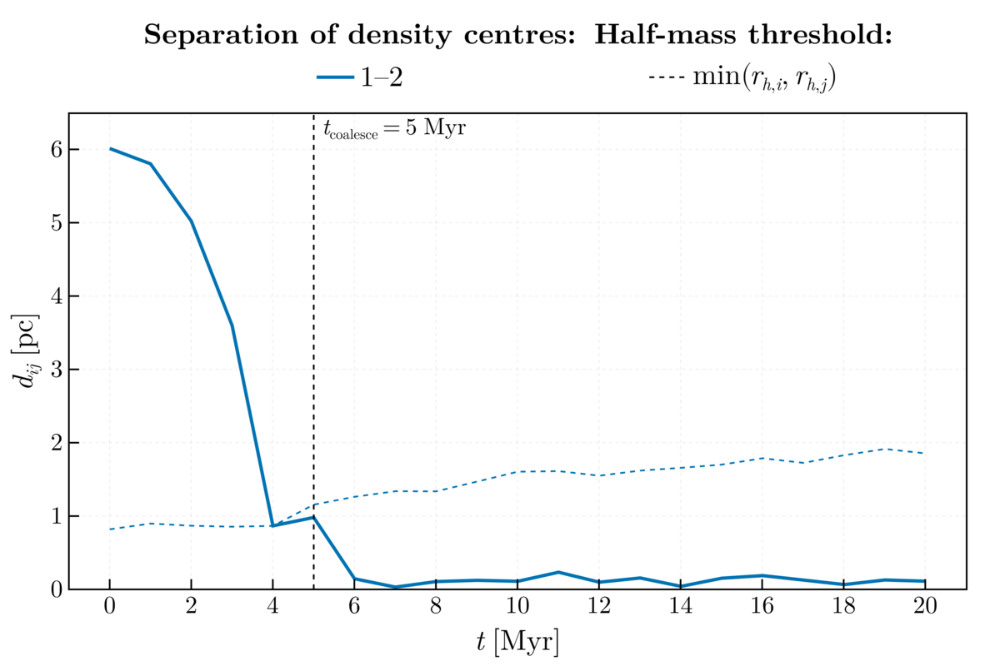
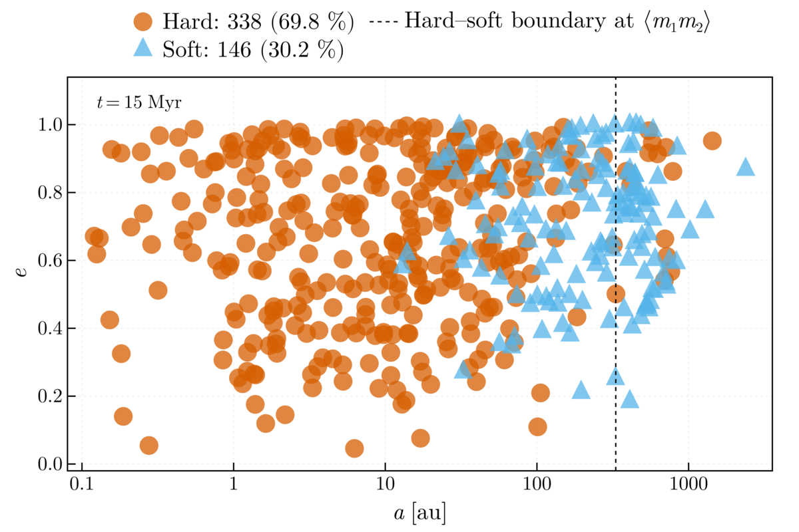
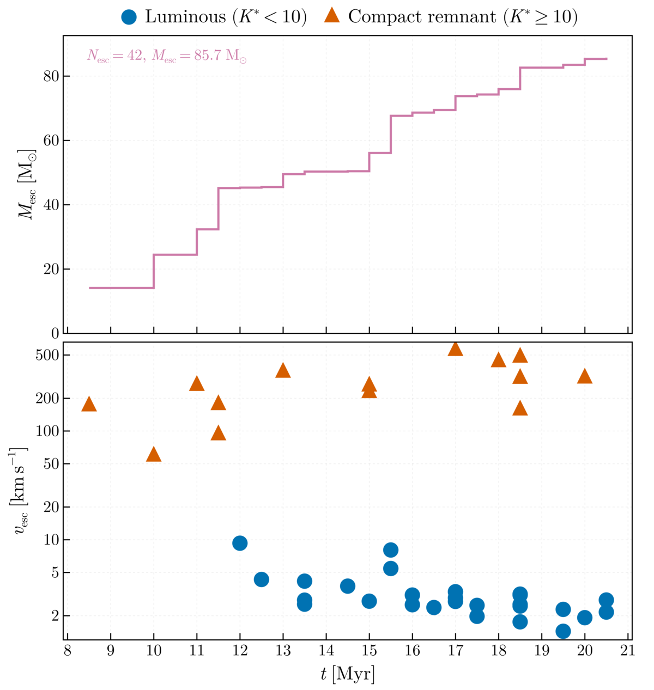
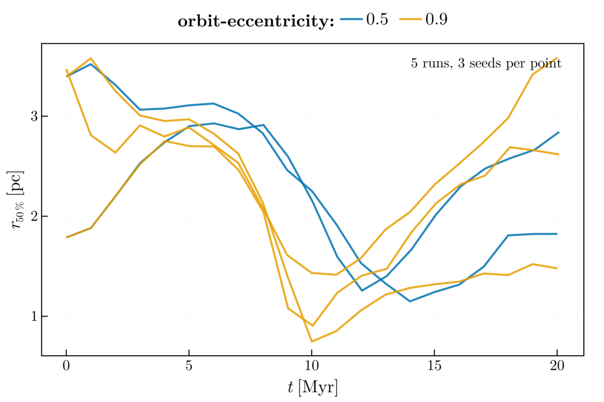
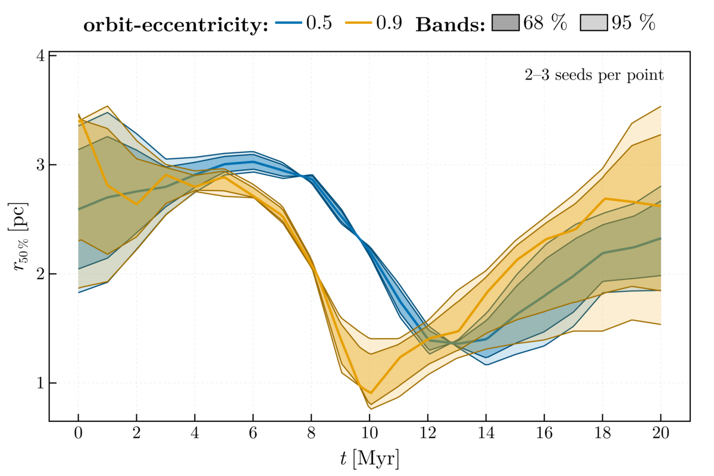

# Showcase Cases

`input_files/showcase/` holds five cases that take the pipeline from a merger
configuration to a finished, figured run: four small ones that complete within
minutes on a workstation, and the 2 × 25 000-star merger over 50 Myr at which
the package's CUDA path was validated. Each case is a merger TOML with a
matching pipeline TOML (paths relative to the folder), so one invocation runs
it end to end:

```bash
julia scripts/run_setup.jl input_files/showcase/equal_pipeline.toml     # also binary_, tidal_, flagship_
julia scripts/run_sweep.jl input_files/showcase/sweep.toml               # the sweep with its controls
```

Every case gives its intervals in Myr (`tcrit_myr`, `dtadj_myr`, `deltat_myr`,
`dtplot_myr`), so the merger, its isolated control and the points of the sweep
cover the same physical span whatever their N-body time unit; the pipeline
TOMLs use the AVX engine built under `backend/Nbody6PPGPU-beijing`
(`gpu/gpu_pipeline.toml` builds the CUDA variant) and write into `runs/`.

## The cases

| Case | Clusters | Orbit | Span | Tolerance `qe` | What it shows |
|---|---|---|---|---|---|
| `equal` | 2 × 4000, King `W0 = 6`, `r_h = 1` pc, Kroupa 0.1–50 M☉ | apocentre 6 pc, `e = 0.9` | 20 Myr | 0.01 | an equal pair that falls together and coalesces within the run; the remnant sheds a halo of loosely bound stars |
| `binary` | 4000 (`W0 = 6`, 1 pc) + 1000 (`W0 = 5`, 0.7 pc), `q ≈ 0.25`, 20 % primordial binaries in both | apocentre 5 pc, `e = 0.7` | 15 Myr | 0.01 | the binary suite (pair counts with the hard/soft split, `a`–`e` diagrams, period distributions) on an unequal pair, and the relaxed tolerance a binary-rich run needs |
| `tidal` | 2 × 2500 as `equal` | apocentre 6 pc, `e = 0.9`, point-mass galaxy of 10¹¹ M☉ at 8.5 kpc (`KZ(14) = 2`) | 20 Myr | 0.05 | the same encounter inside an external field: escapers removed on the distance criterion, and an engine energy check that measures the tidal work rather than the integration error |
| `sweep` | 2 × 500, King `W0 = 6`, `r_h = 1` pc | apocentre 5 pc, `e ∈ {0.5, 0.9}`, seeds 2, 3, 4, with an isolated control per point | 20 Myr | 0.01 | a twelve-point grid: comparison figures on common axes, seed ensembles with 68/95 % bands, and each merger against its control |
| `flagship` | 2 × 25 000, King `W0 = 6`, `r_h = 2` pc, Kroupa 0.08–100 M☉ | apocentre 10 pc, `e = 0.5` | 50 Myr | 0.01 | the merger of the hardware validation: the same configuration as `gpu/merger_50k.toml`, run on every validated host on both engine builds |

The infall time from apocentre is half the Kepler period, so the eccentric
cases coalesce early in the run (`equal` at about 3 Myr) and the sweep's two
eccentricities separate in time (12 Myr at `e = 0.5` against 8 Myr at
`e = 0.9`), which is what its eccentricity axis is for.

## Reference runs

The cases were run on 2026-10-23 on a laptop (Intel Core Ultra 7 155H, four
OpenMP threads per run and eight for the flagship, the small cases four at a
time; package commit `063a40a` (plus the source-layout move of the following commit, which changed no code), engine pin `v2026.07.9`). Engine wall
time is the integration alone; the pipeline adds the initial conditions, the
readers, the diagnostics and about fifty figures and five animations per run,
a few minutes at these sizes.

| Case | Run | Bodies after truncation | Engine wall | Final `DETOT` |
|---|---|---|---|---|
| `equal` | `merger_showcase_equal_20261023_154447_8ace` | 6894 | 149 s | +2.2×10⁻³ |
| `binary` | `merger_showcase_binary_20261023_154448_eb6e` | 4212, 703 primordial pairs | 235 s | −2.4×10⁻² |
| `tidal` | `merger_showcase_tidal_20261023_154446_b65d` | 4301 | 79 s | +4.2×10⁻³ (`ETIDE` −3.3×10⁻³, the tidal work) |
| `sweep` | `sweep_showcase_20261023_154908` | 737–802 per merger, 995–999 per control | 114–146 s per point, four at a time | ≤ 4.3×10⁻² in magnitude over the eleven finished points; the merger at `e = 0.5`, seed 4 stalled at 15 Myr and was killed |
| `flagship` | `merger_showcase_flagship_20261023_154446_4dd7` | 39 283 | 2044 s (34 min; AVX build, eight threads) | −1.1×10⁻³ |

`DETOT` is the engine's cumulative relative energy change at the end of the
run; the merger runs evolve stars and form binaries, so it sits well above
the 10⁻⁷ of a quiet single cluster. The binary case carries the largest
value: its 700 primordial pairs lose mass through stellar evolution while
regularised, and since `v2026.07.7` the engine books those mass changes in
the energy correction instead of leaving them in the error, which moved the
column from the +3.9×10⁻³ of the runs before the pin. The documentation
assets (`docs/src/assets/`) are rendered from these runs, the README montage
and animation from the flagship; `docs/src/assets/PROVENANCE.md` records the
figure routines and arguments.

## What the cases show



*`equal`: the separation of the two density centres falls below the smaller
half-mass radius at 5 Myr, the coalescence time the merger tree records;
after that the two centres of the single remnant stay within 0.3 pc.*



*`binary`: the regularised pairs at the end of the run in the a–e plane, hard
and soft by the Heggie criterion at the mean pair mass; the hard fraction
rose from 66 % to 70 % over the 15 Myr as the soft pairs were disrupted.*



*`tidal`: escapers removed at the tidal boundary of the external field. The
luminous stars leave at a few km/s; the compact remnants carry their natal
kicks at 10²–10³ km/s.*



*`sweep`: the half-mass radius of the five finished mergers on common axes.
The infall is half a Kepler period from apocentre, so the eccentric pairs
collapse first, around 9 Myr, and the `e = 0.5` pairs two to three Myr later;
each remnant then re-expands.*



*`sweep`: the same series as seed ensembles, the median per eccentricity with
its 68 and 95 % bands. The point at `e = 0.5` has two seeds after the stalled
run; the sweep figures and summary are drawn from whatever finished, and
`sweep_index.toml` records the killed point with its status.*


The `flagship` configuration is the merger of the hardware validation
(`gpu/merger_50k.toml` is identical in content to `flagship_merger.toml`,
header comment and table order aside). Its integration over 45.8 N-body units, 50.6 Myr, at eight host
threads measured in the validation chains of 2026-09-24 to 2026-09-26:

| Host | CUDA build | AVX build |
|---|---|---|
| RTX 5090, Ryzen 9 9950X | 360 s | 636 s |
| RTX 5070 Ti, i9-13900KS | 388 s | 821 s |
| H200 NVL, EPYC 9755 | 454 s | 851 s |
| RTX 2080 Super Max-Q, i7-10750H | 954 s | 2136 s |
| Tesla T4, EPYC 7551P | 1470 s | 4192 s |

At this size the device removes about half of the work, because the
irregular force, host work in both builds, is as large as the regular force;
the gain grows with N (see the manual, [Validated hardware](@ref)).

## What a run produces

`runs/<run_id>/` holds the frozen `config.toml`, `environment_manifest.toml`,
`RUN_INFO.toml` (timing, the thread layout, the hardware fingerprint, the
commits, the telemetry summary), `nbody6dynamics.log`, `telemetry.csv`, the
engine output under `output/` (`BUILD_INFO.toml`, `conf.3_*` snapshots,
`out1000`, `lagr.7`, `esc.11`, `sev.83_*`, `bev.82_*`, `merger.inp`, `dat.10`,
`merger_summary.txt`, `merger_ic.toml`), the derived tables
(`stellar_census.csv`, `snapshot_integrals.csv`, `energy_intervals.csv`,
`engine_events.csv`, `mass_budget.csv`, `energy_budget.csv`,
`angular_momentum.csv`, `equipartition.csv`, `remnant_diagnostics.csv`,
`progenitor_budget.csv`, `merger_tree.csv`, the validity record
`validity.toml` with `validity_snapshots.csv`, and, with their stages on,
`binary_spans.csv`, `bound_spans.csv`, `binary_census.csv` and
`binary_population.csv`) and `plots/`:

- initial conditions: projections, overview, velocity field, sampled IMF, density profiles (`merger_ic_*`);
- the encounter: cluster separation, per-cluster virial ratio and structure, density profiles and velocity dispersions at the first and last snapshot (`merger_*`);
- the system: energy error and particle count, Lagrangian radii, escapers and their anisotropy, snapshots (`energy`, `particle_count`, `lagrangian_radii`, `escapers`, `escape_anisotropy`, `snapshot_*`);
- the stars: HR diagrams at three epochs and their evolution, mass segregation, the evolutionary clock, core masses (`hr_*`, `mass_segregation`, `evolutionary_clock`, `core_mass_growth`);
- the binaries: population and hardness, orbital elements, periods (`binary_*`);
- the remnant: structure, rotation, rotation profile, mass segregation (`remnant_*`);
- the run itself: telemetry (`telemetry`);
- animations: the cluster in three projections, the Lagrangian radii, the HR diagram (`*_anim.gif`, `cluster_evolution_*.gif`).

A sweep adds `sweep_index.toml`, `sweep_summary.csv` and, under its `plots/`,
the comparison figures (`sweep_lagrangian`, `sweep_energy`), the ensemble
bands (`ensemble_*`) and the merger-against-control figure
(`control_lagrangian`). The figure routines are documented in the manual,
[Visualisation](@ref "10. Visualisation"), and in the [API Reference](@ref).
